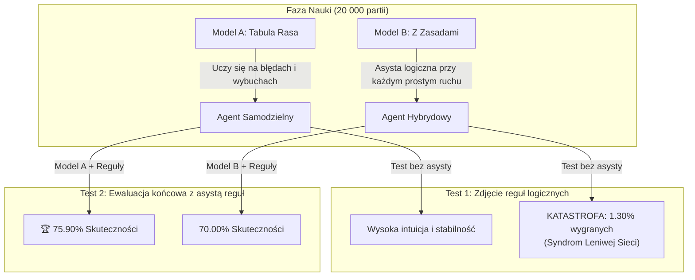

# 💣 AI Saper (Minesweeper DDQN)

> **Inteligentny agent Deep Reinforcement Learning rozwiązujący grę Saper za pomocą algorytmu Double Deep Q-Networks (DDQN), konwolucyjnych sieci neuronowych (CNN) oraz dedykowanego środowiska symulacji z GUI.**

---

## 📌 Spis treści
1. [O Projekcie](#-o-projekcie)
2. [Problem Badawczy: Dlaczego 100% to mit?](#-problem-badawczy-dlaczego-100-to-mit)
3. [Eksperyment: "Syndrom Leniwej Sieci" (Paradoks Kółek Bocznych)](#-eksperyment-syndrom-leniwej-sieci)
4. [Architektura Sieci i Algorytm](#-architektura-sieci-i-algorytm)
5. [Środowisko i System Nagród](#-środowisko-i-system-nagr%C3%B3d)
6. [GUI i Odtwarzacz Powtórek (Replayer)](#-gui-i-odtwarzacz-powt%C3%B3rek-replayer)
7. [Struktura Repozytorium](#-struktura-repozytorium)
8. [Instalacja i Wymagania](#-instalacja-i-wymagania)
9. [Uruchomienie i Użycie](#-uruchomienie-i-u%C5%BCycie)
10. [Podsumowanie i Wnioski](#-podsumowanie-i-wnioski)

---

## 🧠 O Projekcie

Projekt stanowi implementację i badanie agenta uczenia ze wzmocnieniem (*Reinforcement Learning*) grającego w klasyczną grę **Saper (Minesweeper)**. 

W przeciwieństwie do gier o pełnej informacji (jak Szachy czy Go), Saper jest grą z **niepełną informacją (*Imperfect Information Game*)**, w której gracz musi balansować pomiędzy logiczną dedukcją, kalkulacją prawdopodobieństwa a podejmowaniem ryzyka w sytuacjach czysto losowych.

### Główne cechy projektu:
* **Autorskie środowisko gry (`SaperEnv`)**: Zgodne z konwencją RL, wyposażone w mechanizm bezpiecznego pierwszego ruchu, kaskadowe odkrywanie pustych pól oraz pełną serializację trajektorii.
* **Architektura DDQN + CNN**: Przejście z warstw w pełni połączonych (*Dense/Linear*) na trójwarstwową sieć splotową (*Conv2D*), która „zobaczyła” przestrzenny kontekst sąsiedztwa $3 \times 3$.
* **Silnik logiczny (Heurystyka)**: Moduł weryfikujący deterministycznie bezpieczne pola na podstawie reguł sąsiedztwa i liczby min.
* **Interaktywne GUI (Tkinter Replayer)**: Narzędzie do analizy krok-po-kroku, wizualizujące nie tylko stan planszy, ale także wartości **Q (Main & Target Network)** oraz oznaczające decyzje eksploracyjne vs eksploatacyjne.

---

## 🎲 Problem Badawczy: Dlaczego 100% to mit?

W Saperze układ planszy regularnie generuje sytuacje typu **50/50 („rzut monetą”)**, w których żadna logika matematyczna ani sieć neuronowa nie posiada informacji pozwalającej jednoznacznie wskazać bezpieczne pole.

```
[ 1 ] [ ? ]
[ 1 ] [ ? ]
```
*(W powyższej sytuacji jedna z zakrytych komórek kryje bombę – szansa na sukces to czysty rzut monetą 50%).*

Nawet grając optymalnie i minimalizując ryzyko w każdym ruchu, istnieje **teoretyczny sufit wygranych**, który maleje wraz ze wzrostem rozmiaru planszy i zagęszczenia min:

| Rozmiar planszy | Liczba min | Szansa na idealną planszę (bez zgadywania) | Teoretyczny sufit optymalnego gracza |
| :---: | :---: | :---: | :---: |
| **$5 \times 5$** | 2 | ~72.83% | **~95.65%** |
| **$6 \times 6$** | 4 | ~33.20% | **~88.65%** |
| **$7 \times 7$** | 7 | ~12.50% | **~78.00%** |

Celem projektu nie było osiągnięcie nierealnego 100%, lecz maksymalne zbliżenie się do teoretycznego sufitu idealnego gracza.

---

## 🔬 Eksperyment: Syndrom Leniwej Sieci

### Starcie dwóch filozofii uczenia na planszy $7 \times 7$ (7 min, 20 000 partii)

W projekcie przeprowadzono badanie porównujące dwa skrajne podejścia do treningu agenta:
1. **Model A („Od zera” / *Tabula Rasa*)**: Rzucony na głęboką wodę. Brak jakichkolwiek podpowiedzi. Pełna swoboda popełniania błędów, wybuchania i samodzielnego odkrywania prawideł gry.
2. **Model B („Z zasadami” / *Podejście hybrydowe*)**: Od 1. epizodu wspomagany deterministycznym silnikiem reguł. Oczywiste ruchy wykonywał algorytm, a sieć miała włączać się tylko wtedy, gdy logika się zablokowała.



### Wyniki eksperymentu

* **Sprawdzian bez kółek bocznych (wyłączona asysta logiczna)**:
  * Model B trenowany z ciągłą asystą doświadczył całkowitego załamania – jego skuteczność spadła do **1.30%**. Sieć neuronowa stała się „leniwa”: z powodu wyręczania przez algorytm nie wykształciła elementarnych reprezentacji otoczenia.
* **Sprawdzian z pełną asystą logiczną**:
  * **Model A („Od zera”): 75.90% wygranych**
  * **Model B („Z zasadami”): 70.00% wygranych**

> [!IMPORTANT]
> **Kluczowy wniosek badawczy:**
> W uczeniu ze wzmocnieniem swoboda popełniania błędów i ponoszenia ich konsekwencji w fazie eksploracji jest fundamentem generalizacji. Model, który musiał uczyć się na własnych porażkach, wykształcił znacznie lepszą intuicję probabilistyczną na trudne momenty gry niż model wychowany w „cieplarnianych” warunkach asysty heurystycznej.

---

## 🏗 Architektura Sieci i Algorytm

### 1. Od warstw Linear do Conv2D („Jak daliśmy AI wzrok”)
Początkowe eksperymenty z gęstą siecią liniową (MLP) sprawiały, że agent widział planszę spłaszczoną do wektora $N^2$ liczb („patrzenie przez wąską rurkę piksel po pikselu”). 

Wprowadzenie warstw **Conv2D z paddingiem 1** pozwoliło sieci naturalnie przetwarzać zależności lokalne w matrycy $3 \times 3$ wokół każdej komórki, radykalnie przyspieszając zbieżność i podnosząc sufit skuteczności.

```
Wejście: Tensor [Batch, 1, Rozmiar, Rozmiar]
   │
   ├── Conv2d(1 -> 64, kernel=3, padding=1) + ReLU
   │
   ├── Conv2d(64 -> 128, kernel=3, padding=1) + ReLU
   │
   ├── Conv2d(128 -> 256, kernel=3, padding=1) + ReLU
   │
   ├── Flatten
   ├── Linear(256 * Rozmiar * Rozmiar -> 256) + ReLU
   └── Linear(256 -> Rozmiar * Rozmiar)  --> [Wartości Q dla każdego pola]
```

### 2. Double Deep Q-Network (DDQN)
W celu wyeliminowania systematycznego przeszacowywania wartości Q (*Overestimation Bias*), zastosowano dwa odrębne zestawy wag:
* **Sieć główna (Policy Network, $\theta$)**: Wybiera najlepszą akcję:
  $$a^* = \arg\max_a Q(s', a; \theta)$$
* **Sieć docelowa (Target Network, $\theta^-$)**: Wyznacza wartość wybranej akcji:
  $$Y_t = r + \gamma Q(s', a^*; \theta^-)$$
* **Aktualizacja wag Target Network**: Wykorzystano miękką aktualizację (*Soft Update*):
  $$\theta^- \leftarrow \tau \theta + (1 - \tau) \theta^- \quad (\tau = 0.005)$$

### 3. Maskowanie akcji (Action Masking)
Sieć neuronowa ocenia wszystkie pola planszy, jednak moduł decyzyjny nakłada maskę logiczną:
* Pola już odkryte lub oflagowane otrzymują wartość $-\infty$,
* Wybór algorytmu $\varepsilon$-greedy następuje wyłącznie z puli pól zakrytych (`val < 0`).

---

## 🎮 Środowisko i System Nagród

Stan planszy jest normalizowany do przedziału numerycznego:
* Pole zakryte: `-0.1`
* Flaga: `-0.2`
* Liczba sąsiadujących min ($0 \dots 8$): `liczba / 8.0`

### Kształtowanie funkcji nagrody (*Reward Shaping*):
* **Poprawne odkrycie bezpiecznego pola**: `+0.4`
* **Wygrana partia**: `+120.0`
* **Trafienie na minę (przegrana)**: `-15.0`
* **Postawienie flagi na minie**: `+0.1`
* **Błędne / nadmiarowe akcje**: `-0.1` do `-0.5`

Środowisko gwarantuje, że **pierwszy ruch gracza jest zawsze bezpieczny** – miny są generowane po wykonaniu pierwszego strzału z wyłączeniem strefy $3 \times 3$ wokół punktu startowego.

---

## 🖥 GUI i Odtwarzacz Powtórek (Replayer)

Aplikacja `MinyGUI.py` (napisana w Tkinter) umożliwia inspekcję nagranych partii zapisanych w formacie JSON w katalogu `zapisy/`.

Funkcje Replayera:
* ⏪ / ⏩ Krokowe przewijanie rozgrywki (przód/tył).
* 🤖 / 🎲 Wizualne rozróżnienie: ruch podjęty przez **Sieć Neuronową (AI)** vs ruch w trybie **Eksploracji Losowej (LOS)**.
* 📊 Podgląd wartości $Q$ w czasie rzeczywistym dla każdego zakrytego pola:
  * `M: ...` – predykcja sieci głównej (*Main Network*)
  * `T: ...` – predykcja sieci docelowej (*Target Network*)
* 💣 Pełne odsłonięcie rozkładu min po zakończeniu rozgrywki.

---

## 📂 Struktura Repozytorium

```text
AI_MINY/
│
├── Agent.py              # Definicja sieci CNN (SaperNet), agenta DDQNAgent oraz silnika reguł
├── Miny.py               # Środowisko Sapera (SaperEnv), logika gry, nagrody, zapis do JSON
├── MinyGUI.py            # Graficzny odtwarzacz powtórek z wizualizacją Q-wartości (Tkinter)
├── train.py              # Pętla treningowa agenta, harmonogram LR, wykresy zbieżności
├── evaluate.py           # Benchmark i ewaluacja skuteczności modeli (z zasadami / bez zasad)
│
├── modele/               # Wytrenowane checkpointy wag modeli PyTorch (.pth)
│   ├── saper_5x5x2_sieć32_bez_zasad.pth
│   ├── saper_6x6x4_sieć64_bez_zasad.pth
│   ├── saper_6x6x4_sieć64_z_zasadami.pth
│   ├── saper_7x7x7_sieć32_bez_zasad_20000.pth
│   └── ...
│
├── zapisy/               # Telemetria z rozgrywek (JSON) do odtworzenia w GUI
│   ├── powtorka_10_....json
│   └── ...
│
├── miny.docx             # Opracowanie teoretyczne i konspekt badania naukowego
├── requirements.txt      # Zależności i pakiety Pythona
└── README.md             # Dokumentacja projektu
```

---

## ⚙️ Instalacja i Wymagania

### 1. Klonowanie repozytorium
```bash
git clone https://github.com/twoj-login/AI_MINY.git
cd AI_MINY
```

### 2. Tworzenie środowiska wirtualnego
```bash
python -m venv .venv
# Windows:
.venv\Scripts\activate
# Linux/macOS:
source .venv/bin/activate
```

### 3. Instalacja zależności
```bash
pip install -r requirements.txt
```
*(Tkinter jest wbudowany w standardową dystrybucję Pythona na systemie Windows).*

---

## 🚀 Uruchomienie i Użycie

### 1. Odtwarzanie nagranych rozgrywek (GUI)
Aby przejrzeć decyzje podejmowane przez model krok po kroku:
```bash
python MinyGUI.py
```
Kliknij **"Wgraj powtórkę"** i wybierz dowolny plik z folderu `zapisy/`. Użyj przycisków **"Następny ➡"** i **"⬅ Poprzedni"** do nawigacji.

---

### 2. Ewaluacja i benchmark modeli
Aby przetestować skuteczność zapisanego modelu na deterministycznym zbiorze nasion plansz:
```bash
python evaluate.py
```
Przykładowy wynik:
```text
--- WYNIKI DLA: modele/saper_6x6x4_sieć64_bez_zasad.pth (Zasady: False) ---
Skuteczność: 71.40%
Średnia liczba kroków w grze: 7.21

--- WYNIKI DLA: modele/saper_6x6x4_sieć64_bez_zasad.pth (Zasady: True) ---
Skuteczność: 84.10%
Średnia liczba kroków w grze: 6.89
```

---

### 3. Trening nowego agenta
Aby uruchomić proces uczenia ze wzmocnieniem:
```bash
python train.py
```
Możesz dostosować parametry wewnątrz `train.py`:
* `wielkosc_planszy` i `liczba_min`
* `episodes` (liczba epizodów)
* `batch_size` (domyślnie 128)
* `use_rules` (trening Tabula Rasa vs trening Hybrydowy)

---

## 📊 Podsumowanie i Wnioski

1. **Konwolucja jest kluczem w grach planszowych**: Sieć 2D CNN deklasuje tradycyjne warstwy liniowe w Saperze, ponieważ potrafi ekstrahować lokalne wzorce numeryczne w promieniu $3 \times 3$.
2. **Double DQN stabilizuje uczenie**: Rozdzielenie wyboru akcji od estymacji jej wartości zapobiega niekontrolowanemu wzrostowi wartości Q.
3. **Syndrom Leniwej Sieci**: Wyręczanie modelu zaawansowanymi regułami pomocniczymi na wczesnym etapie uczenia uniemożliwia wykształcenie głębokich reprezentacji w sieci. Najlepsze wyniki osiąga model, który uczył się w trudnych warunkach (*Tabula Rasa*), a reguły logiczne otrzymał dopiero jako moduł wspomagający na etapie inferencji produkcyjnej.

---
*Projekt zrealizowany w ramach badań nad uczeniem ze wzmocnieniem w grach o niepełnej informacji.*
